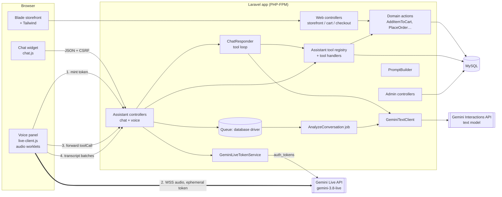
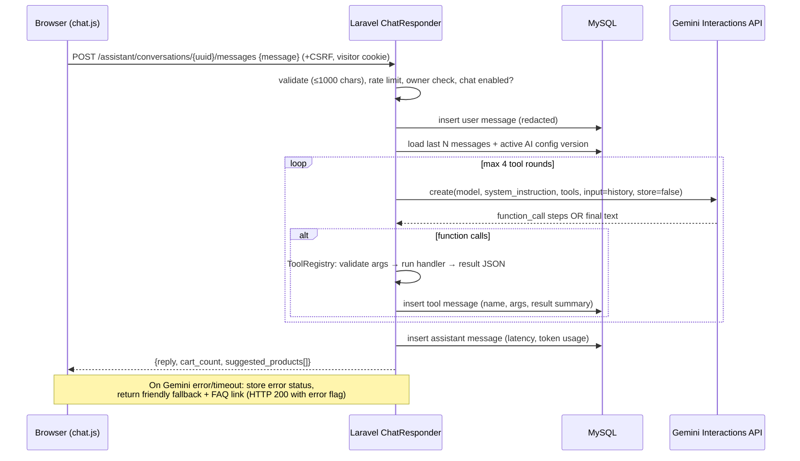
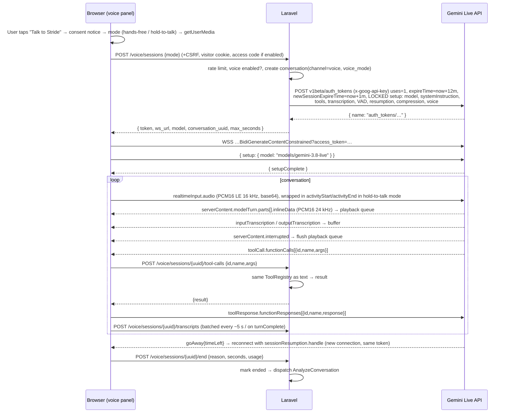
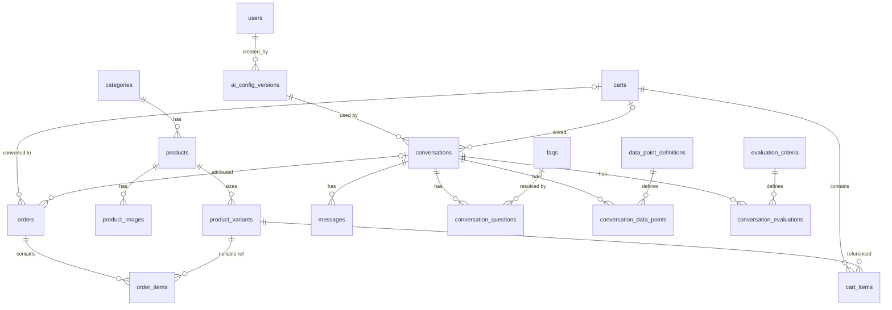
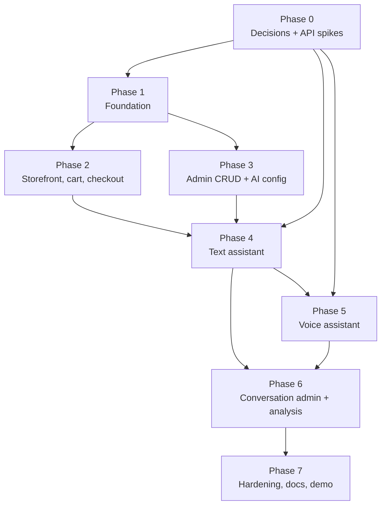

#  AI Ecommerce Assistant Prototype: Technical Blueprint

> **Status:** Planning document, revision 2. No application code yet.
> **Prepared:** 23 October 2026. All "Verified" claims below were checked against official Google AI for Developers, Laravel and Laravel Forge documentation on this date (doc "last updated" dates noted where relevant). Re-verify anything marked **[A]** or **[C]** in Phase 0 before building on it.
> **Revision 2:** incorporates the product owner's decisions (§12): Laravel 13, "custom filters" = answer success/failure, demo-only pricing, Laravel Forge + GoDaddy domain, possibly public, mobile + desktop.
> **Suggested location in repo:** `docs/BLUEPRINT.md`

**Legend used throughout**

| Tag | Meaning |
|---|---|
| **[V]** | Verified in current official documentation |
| **[C]** | Official docs conflict with each other — must be settled by a Phase 0 spike |
| **[A]** | Assumption / engineering judgement — not a documented guarantee |

---

## 0. Executive summary

A fictional shoe store ("Stride") built as a conventional **Laravel 13** + MySQL + Blade + Tailwind app, responsive on phones and desktops, deployed with Laravel Forge on a GoDaddy-registered domain. It has three AI surfaces:

1. **Text assistant** — server-side only. Laravel calls the Gemini text API, runs a bounded tool-calling loop against trusted PHP functions (product search, size availability, FAQs/knowledge, cart), and stores every turn.
2. **Voice assistant** — browser connects **directly** to the Gemini Live API (`gemini-3.8-live`) over WebSocket using a **short-lived, single-use, config-locked ephemeral token** minted by Laravel. When Gemini requests a function call, the browser forwards it to a Laravel endpoint that executes the *same* PHP tools as the text assistant, then relays the result back to Gemini.
3. **Post-conversation analysis** — a queued job uses the text model with structured output to (a) mark every customer question as **answered from the store's data or not** — which drives the admin's success/failed filter and a "Knowledge gaps" list — (b) extract admin-defined data points, and (c) grade admin-defined evaluation criteria.

The design keeps all business logic (pricing, stock, cart, orders) in Laravel action classes shared by the UI, the text assistant and the voice assistant. The model never computes prices or places orders.

### The six decisions that matter most

1. **Laravel 13, not 12** (decided). Laravel 12 is security-fixes-only; Laravel 13 has security support to 17 March 2028 (§1.1).
2. **Voice must be client-to-server.** PHP-FPM cannot hold a long-lived bidirectional WebSocket proxy, and Google's documented browser path is ephemeral tokens + direct WebSocket. This forces a deliberate trust model for tool calls and transcripts (§5).
3. **Live function calls execute on the client, not at Google.** The browser receives `toolCall` messages and must answer them; we turn that into an authenticated call to Laravel (§2.5).
4. **`gemini-3.8-live` does not support structured outputs, `thinkingLevel`, or turning proactive audio off.** Extraction/evaluation must run afterwards on a text model (§2.6).
5. **No vector database in the MVP.** A catalog of ~40 products and ~30 FAQ/knowledge entries is better served by tool calls over MySQL than by embeddings (§2.3). (Laravel 13's built-in vector search targets PostgreSQL + pgvector, not MySQL [V].)
6. **Voice on phones needs a "hold to talk" mode.** On a phone speaker the model hears itself and interrupts its own answers; hold-to-talk sidesteps echo entirely and is the default on touch devices (§2.7).

---

## 1. Ambiguities, challenged assumptions and technical risks

### 1.1 Challenged assumptions

| # | Your assumption | Challenge | Recommendation |
|---|---|---|---|
| 1 | **Laravel 12** | **[V]** Laravel 12's bug-fix window ended 13 Aug 2026; security fixes end 24 Feb 2027. Laravel 13 (PHP 8.3–8.5) was released 17 March 2026, with security fixes until 17 March 2028. | **Decided: Laravel 13**, PHP 8.4 or 8.5 on the server. Useful 13 additions we will use: job attributes (`#[Tries]`, `#[Backoff]`, `#[Timeout]`) and origin-aware `PreventRequestForgery` CSRF protection [V]. |
| 2 | "Blade and Tailwind" + auth | **[V]** Laravel's official starter kits (checked in the 12.x docs) are React, Vue, Svelte, or Livewire (Livewire 4 + Flux UI). There is no plain-Blade kit; Breeze is no longer updated. Using the Livewire kit adds Livewire, Flux and Fortify — a second frontend paradigm. | **No starter kit.** Admin-only auth is ~1 controller with Laravel's built-in session guard and `RateLimiter`. Customers check out as guests. Vanilla JS ES modules (bundled by Vite) for the two interactive islands: chat widget and voice panel. |
| 3 | A voice "conversation experience" equal to the text bot | Voice and text have different constraints: ~10-minute connection lifetime, 15-minute audio-only session without compression, no structured outputs, client-side tool execution, transcripts produced in the browser. | Treat voice as a **separate conversation channel** sharing the same tools, cart and visitor. Keep it scoped: browse, ask, check sizes, add to cart. **Never place an order by voice**; checkout requires an on-screen click. |
| 4 | Chatbot answers from "product information, FAQs and knowledge" | Stuffing the full catalog into the system prompt makes prices/stock stale per session and inflates every request. | Only small, admin-flagged "always include" knowledge (returns policy, shipping) goes in the prompt. Everything else is fetched via **tools** at answer time, so prices and stock are always live. |
| 5 | "Use server-side functions for trusted product lookups" (voice) | With Live, Google sends the function call **to the browser**. The browser can lie to the model or skip calling Laravel. | Accept that a visitor can only deceive their *own* session. All mutations go through Laravel with the same authorization as the normal UI, so a malicious browser can do nothing it couldn't do by clicking. Label voice transcripts as *client-reported* (§5). |
| 6 | Gemini text API = `generateContent` | **[V]** Google now calls the Interactions API GA (June 2026) and recommended for new projects; `generateContent` is "legacy" but fully supported. Interactions stores requests server-side by default (55 days paid / 1 day free tier) unless `store=false`. | Use the **Interactions API in stateless mode (`store=false`)** and keep history in our own MySQL — better privacy, and our DB is the source of truth anyway. Keep the HTTP code in one class so switching to `generateContent` is a one-file change if the spike finds a gap. |
| 7 | Implicit: "use an AI SDK" | **[V]** Laravel 13 highlights a first-party AI SDK (`laravel/ai`) with Gemini text support, tools and test fakes. It brings its own conversation tables and does not cover the Live API. | **Don't adopt it for the MVP.** Our Gemini text surface is two endpoints; the SDK would duplicate our conversation schema and hide provider-specific options (`store=false`). Revisit once the core product works — `GeminiTextClient` is the only class that would change. |
| 8 | "Custom filters" = a generic filter builder | Your meaning (§12) is narrower and more useful: did the assistant answer from the knowledge base / database or not. A generic saved-filter builder is effort without a demo payoff. | Build a first-class **answer outcome** (success / failed) per question and per conversation, a filter on it, and a **Knowledge gaps** page that turns failed questions into new FAQs. Generic saved filters are postponed. |
| 9 | One voice UX for every device | Hands-free voice on a phone speaker causes echo: the model hears its own voice and barges in on itself. Browser echo cancellation helps but is not guaranteed **[A]**. | Two voice modes: **hands-free** (desktop/headphones) and **hold-to-talk** (default on touch devices). Both are documented Live API patterns [V]. |

### 1.2 Ambiguities — resolved and remaining

Resolved by the product owner (details in §12): Laravel 13; custom filters = answer success/failed; demo pricing; Forge + GoDaddy; possibly public; mobile + desktop.

Remaining defaults (my assumption in bold — change any of them before Phase 1):

1. **What counts as "failed"?** **Default:** a customer question fails when the assistant could not answer it from the catalog or the knowledge base (it said it didn't know, deflected, or answered without support from a tool result or always-included knowledge), or when a technical error stopped the reply. **Not** failures: a correct "we don't stock that size" (that *is* an answer from the database), and politely declining off-topic questions ("tell me a joke", "who will win the election") — these are tagged `out_of_scope` and excluded. A conversation is **failed** if any in-scope question failed.
2. **Customer accounts?** **Default: none.** Guest checkout; visitor identified by a random cookie ID.
3. **May the assistant change data?** **Default: it may add/remove cart items** (reversible, visible on screen). It may never create orders, apply discounts, or change prices/stock.
4. **When are data points/evaluations produced?** **Default: after the conversation ends** (explicit end, voice disconnect, or 15 minutes idle), via a queued job. Not live during the chat.
5. **Languages:** **Default: English UI.** The Live model can switch language automatically [V]; the system prompt will ask it to reply in the customer's language but keep product names unchanged.
6. **Currency/prices:** **Default: USD, typical retail range $59–$189, US sizes 6–13 in half sizes**, single fictional brand. Currency symbol from `STORE_CURRENCY` config so it can be switched (e.g. to INR) without code changes. Sizes as variants; colour as a separate product.
7. **Deployment:** decided — Laravel Forge (§11). Browsers only expose the microphone on HTTPS or `localhost` **[A — standard web platform behaviour, not Gemini-specific]**, which Forge's free Let's Encrypt certificates cover [V].
8. **Data retention period:** **Default: 30 days** for conversations, configurable. No audio is ever stored — only transcripts.
9. **Product images:** need a licensing decision — use your own generated images, or a source whose licence permits redistribution in a public repo.
10. **Admin users:** **Default: a single `admin` role**, created by an Artisan command; no public registration.
11. **Public or private demo?** Undecided ("maybe"). **Default: build for public, ship gated.** An optional `ASSISTANT_ACCESS_CODE` puts chat and voice behind a one-time code (the shop itself stays open). Leave it set while sharing the link with selected people; clear it, and switch to a paid-tier Gemini key, only when you decide to go public.
12. **Admin on mobile:** **Default:** the storefront, chat and voice are fully mobile-first; the admin is *usable* on phones (tables collapse to cards, forms stack) but designed primarily for desktop/tablet.

### 1.3 Technical risk register

| Risk | Likelihood / impact | Mitigation |
|---|---|---|
| **Live API and ephemeral tokens are labelled Preview** in the API reference and ephemeral-token guide, even though the `gemini-3.8-live` model page says "Stable" [V/C]. Field names may change. | Medium / High | Keep the entire wire protocol in one JS module (`live-client.js`) and one PHP class (`GeminiLiveTokenService`). Record the exact JSON from the Phase 0 spike as test fixtures. |
| **Token request shape conflict [C]:** the ephemeral-token guide shows `liveConnectConstraints: {model, config}`; the API reference documents `bidiGenerateContentSetup` plus `fieldMask` (with precise lock/override semantics). | High / High | Phase 0 spike S1 must determine which body works over REST and prove the browser **cannot** override the system instruction or tools. |
| **Docs drift on Live tools [C]:** the Tool-use page's support table lists only 3.1 and 2.5 models and says async calling isn't supported on 3.1; the 3.8 model page says `NON_BLOCKING` is now the **default**. Scheduling values are written `INTERRUPT` on one page and `INTERRUPTED` on another. | High / Medium | Declare our tools explicitly as `behavior: BLOCKING` (documented as supported for backwards compatibility on 3.8) so behaviour is deterministic; Laravel lookups return in ~100 ms. Revisit non-blocking later. |
| **Connection lifetime ~10 min; audio-only session 15 min without compression [V].** | Certain / Medium | MVP enables `contextWindowCompression` and `sessionResumption`, caps a voice session at 10 minutes in the UI, and handles `goAway` by resuming with the latest handle (handles valid 2 h) [V]. |
| **Browser audio pipeline** (AudioWorklet, 16 kHz in / 24 kHz out, autoplay rules, echo causing the model to interrupt itself, Safari quirks). | High / High | Spike S2 on Chrome, Edge, Safari, Firefox. Request `echoCancellation`/`noiseSuppression` [A]. Start `AudioContext` only after a tap/click. Flush playback on `interrupted` [V]. Recommend headphones in demos. |
| **Mobile voice** (iOS Safari and Android Chrome): speaker echo, hardware sample rates other than 16 kHz, the page being suspended when the screen locks or the tab is backgrounded, Wi-Fi ↔ mobile-data switches dropping the WebSocket, mobile data use. | High / High | Hold-to-talk default on touch devices (§2.7); send audio with its real rate in the MIME type and let Gemini resample, or downsample in the worklet [V: any rate accepted when declared]; end the session cleanly on `visibilitychange` → hidden; reconnect via session resumption on network change; request a screen wake lock while live **[A: browser support varies]**. Spike S2b on real iPhone and Android devices. |
| **Answer-outcome accuracy** (the success/failed filter is only as good as the classifier). | Medium / Medium | Combine a live signal (model calls `report_knowledge_gap`) with a post-conversation classifier that sees tool results; technical errors are set deterministically; admin can override an outcome. Measure agreement on the golden set (§9). |
| **Untrusted client-side tool execution and transcripts.** | Certain / Medium | Trust model in §5.2. |
| **Hallucinated prices, stock or policies.** | Medium / High | Prices/stock only via tools; prompt rule "never state a price or availability not returned by a tool in this conversation"; golden-set evaluation (§9). |
| **Cost runaway** (voice is billed per audio token; anonymous public demo). | Medium / High | Per-visitor and global rate limits, voice session cap, admin kill switches, usage logging. Verify current prices on the official pricing page before launch. |
| **MySQL FULLTEXT quirks** (min token length, stopwords; "trail" vs "trails"). | Medium / Low | Fulltext in Boolean mode with prefix `*`, plus structured filters (category, size, price, activity), plus `LIKE` fallback for short terms. Tests run against MySQL, not SQLite. **Phase 0 S6 (verified on MySQL 8.4.13):** raw input containing Boolean operators causes SQL error 1064, so the query must be built from sanitised terms only (see `docs/phase-0-findings.md`). |
| **Free-tier data-use terms differ from paid tier.** | Medium / Medium | Use a paid-tier key once any real person uses the demo; check current Gemini API terms. |
| **Public link abuse** (if the demo goes public). | Medium / High | `ASSISTANT_ACCESS_CODE` gate, rate limits, daily caps, kill switches (§5.1). |

---

## 2. Architecture

### 2.1 Component overview



### 2.2 Code organisation (conventional Laravel, no premature abstraction)

```
app/
  Actions/
    Cart/AddItemToCart.php, UpdateCartItem.php, RemoveCartItem.php, ResolveCart.php
    Checkout/PlaceOrder.php                 # transaction, stock lock, totals
    Catalog/SearchProducts.php              # one search implementation for shop + AI
  Assistant/
    Tools/                                  # one class per tool
      AssistantTool.php                     # small interface: name(), declaration(), handle(array $args, ToolContext $ctx)
      SearchProductsTool.php, GetProductTool.php, CheckSizeAvailabilityTool.php,
      SearchKnowledgeTool.php, ViewCartTool.php, AddToCartTool.php, RemoveFromCartTool.php,
      ReportKnowledgeGapTool.php            # live "I couldn't answer this" signal
    ToolRegistry.php                        # validates args, dispatches, logs
    ToolContext.php                         # visitor, cart, conversation, channel
    PromptBuilder.php                       # system instruction for text + voice
    ChatResponder.php                       # bounded text tool loop + persistence
    LiveSessionConfig.php                   # builds the locked Live setup
  Services/Gemini/
    GeminiTextClient.php                    # Interactions API over Laravel HTTP client
    GeminiLiveTokenService.php              # auth_tokens minting
    GeminiException.php
  Analysis/
    ConversationAnalyzer.php                # answer outcomes + data points + evaluations via structured output
  Jobs/AnalyzeConversation.php
  Http/Controllers/{Shop,Assistant,Voice,Admin}/...
  Http/Requests/...                         # all validation in FormRequests
  Http/Middleware/EnsureVisitorId.php, EnsureConversationOwner.php, EnsureAssistantAccess.php
  Models/...
  Policies/... (only where needed)
resources/js/
  chat.js, voice/live-client.js, voice/audio-capture.worklet.js, voice/audio-playback.js, voice/pcm.js
resources/views/{layouts,shop,admin,components}/...
```

The **only** interface is `AssistantTool`, because there are genuinely 8 implementations. Gemini classes are concrete; tests use `Http::fake()`.

### 2.3 Knowledge strategy (no RAG infrastructure in MVP)

| Source | Size (seed) | How the model gets it |
|---|---|---|
| Store identity, tone, rules | 1 prompt | System instruction (admin-edited, versioned) |
| "Always include" knowledge (returns, shipping, warranty) | ≤ 1,500 words total, enforced by validation | Appended to system instruction |
| Products, variants, stock, prices | ~40 products × ~8 sizes | `search_products`, `get_product`, `check_size_availability` tools |
| FAQs + other knowledge articles | ~30 entries | `search_knowledge` tool (MySQL FULLTEXT) |
| Cart | per visitor | `view_cart`, `add_to_cart`, `remove_from_cart` tools |
| "I can't answer this" | — | `report_knowledge_gap` tool — the prompt tells the model to call it whenever neither a tool result nor the always-included knowledge answers the question, then to say so honestly and offer the help page |

Embeddings are postponed until the knowledge base outgrows keyword search (§10).

### 2.4 Flow A — Text chat turn



Rules: 20 s total timeout; 1 retry on 429/5xx with jitter; tool loop hard-capped at 4 rounds; history window = last 20 messages (older context dropped in MVP).

### 2.5 Flow B — Voice session



### 2.6 Flow C — Post-conversation analysis

1. A conversation ends (explicit end, voice end, or the scheduled `assistant:close-idle` command after 15 min idle).
2. `AnalyzeConversation` job (database queue, `#[Tries(3)]`, `#[Backoff]`) loads the transcript, the tool calls and their results, any `report_knowledge_gap` calls, active data-point definitions and evaluation criteria.
3. Three calls to the text model with **structured output**, kept separate so one bad rubric can't corrupt the others:
   - **Answer outcomes** (fixed schema, not admin-defined): list each distinct customer question with `outcome` = `answered | not_answered | out_of_scope`, `source` = `catalog | knowledge | both | none`, a short reason, and a topic label. The classifier is told that an answer only counts as `answered` if it is supported by a tool result or the always-included knowledge shown to it.
   - **Data points** (schema generated from admin definitions).
   - **Evaluations** (schema generated from admin criteria).
4. Results are validated (types, enum options) before insert; invalid values are dropped and logged.
5. The conversation's **outcome** is computed in PHP, not by the model: `failed` if any message has `status=error` or any question is `not_answered`; otherwise `success`. A live `report_knowledge_gap` call with no matching classifier row still creates a `not_answered` question (the model's own admission wins).
6. `analysis_status` goes `pending → done | failed`; admin can re-run analysis or manually override an outcome (stored as `outcome_overridden_by`).

Structured output on the text model is documented for the Interactions API [V]; that it works with the specific default model you choose is **[A]** until spike S4.

### 2.7 Responsive and mobile design

**Storefront (mobile-first Tailwind):** single-column catalog with a filter drawer on phones; sticky "Add to cart" bar on product pages below `md`; large tap targets (≥ 44 px); cart and checkout forms with correct `inputmode`/`autocomplete` attributes; images served in two sizes with `srcset`. Desktop gets the multi-column grid and side filters.

**Chat widget:** floating button on all pages; on screens below `sm` it opens as a **full-screen sheet** (with `100dvh` and safe-area padding so the iOS keyboard doesn't hide the input); on desktop a 380 px panel. Product suggestions render as horizontally scrollable cards.

**Voice panel:** full-screen sheet on phones, side panel on desktop. Large central mic control, live captions, cart badge, "End" button. Two modes chosen *before* the session starts, because the voice-activity setting is part of the locked token:

| Mode | Default on | How it works (all fields [V]) |
|---|---|---|
| Hands-free | Desktop, or any device when the user picks it | Automatic VAD on; `silenceDurationMs` from AI config (500–800 ms recommended); barge-in via `interrupted`. Prompt the user to use headphones on phones. |
| Hold-to-talk | Touch devices (`pointer: coarse`) | `realtimeInputConfig.automaticActivityDetection.disabled = true`; on press the client sends `activityStart` and starts streaming mic audio, on release it sends `activityEnd`. The mic is not streamed while the model is speaking, so speaker echo can't trigger an interruption. Pressing while the model speaks stops local playback first (barge-in by gesture). Docs advise including some audio before `activityStart` with manual VAD, so the client keeps a ~300 ms rolling pre-buffer. |

**Mobile lifecycle rules:** start `AudioContext` and `getUserMedia` inside the tap handler (required by mobile autoplay rules **[A]**); on `visibilitychange` → hidden, end the session with `ended_reason=backgrounded`; on WebSocket close with a resumption handle, reconnect once automatically; show a data-use note — streamed mic audio is ~43 KB/s (16 kHz × 16-bit, base64-encoded), about 2.5 MB per minute of streaming, and model audio is ~64 KB/s (24 kHz) while it speaks, up to about 3.8 MB per minute (calculated from the documented formats). Hold-to-talk streams only while pressed, so it also uses less data.

**Admin:** sidebar collapses to a top menu on phones; data tables become stacked cards below `md`; long forms (AI config) stay single-column.

---

## 3. Verified Gemini API facts (and what they force)

All from ai.google.dev, pages last updated Sept–Oct 2026.

### 3.1 `gemini-3.8-live` model

| Fact | Status | Design consequence |
|---|---|---|
| Model code `gemini-3.8-live`, stable, latest update Sept 2026. Inputs text/images/audio; output text and audio. Input limit 131,072 tokens; output 65,536. | [V] | Config value `GEMINI_LIVE_MODEL=gemini-3.8-live`. |
| Function calling **supported**; Google Search grounding supported; **structured outputs, caching, code execution, file search, URL context not supported**. | [V] | Extraction/evaluation run on a text model after the call. Google Search grounding **disabled** — the assistant must only talk about our store. |
| Thinking: interleaved reasoning; **`thinkingLevel` not supported — omit `thinkingConfig`**. | [V] | Never send `thinkingConfig` in setup. |
| Async function calling (`NON_BLOCKING`) is now the **default**; `behavior: BLOCKING` still supported; scheduling `SILENT` / `WHEN_IDLE` / `INTERRUPT(ED)` supported. | [V] / [C] on enum spelling | Declare tools `BLOCKING` in MVP. |
| **Proactive audio permanently enabled; sending `proactive_audio: false` returns an error.** | [V] | Never send `proactivity.proactiveAudio=false`. Prompt must tell the model it may stay silent on background noise. |
| **Affective dialogue removed** — remove `enable_affective_dialog`. | [V] | Not configurable. |
| **Response modality is audio**; for text, enable output audio transcription. | [V] | `responseModalities: ["AUDIO"]`, `outputAudioTranscription: {}`. |
| Turn coverage defaults to include all video; send frames only when needed. | [V] | We send no video. |
| `sendClientContent` with explicit roles supported throughout the session; `turnComplete: true` interrupts current generation. | [V] | Used to inject "user added X to cart via UI" context if desired (post-MVP). |

### 3.2 Connection, auth and audio

| Fact | Status |
|---|---|
| Endpoint with API key: `wss://generativelanguage.googleapis.com/ws/google.ai.generativelanguage.v1beta.GenerativeService.BidiGenerateContent?key=…` — **server-side only**. | [V] |
| Endpoint with ephemeral token: `…v1beta.GenerativeService.BidiGenerateContentConstrained?access_token={token}`; token may alternatively go in `Authorization: Token …`. Ephemeral tokens now use **v1beta** (older docs and third-party libs say v1alpha). | [V] |
| Live API supports server-to-server auth by default; for client-to-server you need ephemeral tokens. | [V] |
| Mint token: `POST https://generativelanguage.googleapis.com/v1beta/auth_tokens` with header `x-goog-api-key`. Fields: `uses` (default 1; 0 = unlimited; **resuming a session doesn't count as a use**), `expireTime` (default 30 min, must be < 20 h), `newSessionExpireTime` (default 60 s, < 20 h). Token value is returned as `name`. | [V] |
| Tokens can be locked to model and config, which keeps system instructions server-side. | [V] |
| Exact JSON body for locking (`liveConnectConstraints` vs `bidiGenerateContentSetup` + `fieldMask`) and override semantics. | **[C]** |
| First client message must be `setup` (`model: "models/{model}"`); wait for `setupComplete`. Configuration can't change mid-connection (except via resumption, not the model). | [V] |
| Each client message has exactly one of `setup`, `clientContent`, `realtimeInput`, `toolResponse`. | [V] |
| Input audio: raw 16-bit PCM, little-endian; natively 16 kHz but other rates are resampled if `mimeType` states the rate (`audio/pcm;rate=16000`). Output: raw 16-bit PCM LE at **24 kHz**, base64 in `serverContent.modelTurn.parts[].inlineData.data`. | [V] |
| `realtimeInput.audioStreamEnd: true` should be sent when the mic pauses > 1 s. | [V] |
| Automatic VAD on by default; `silenceDurationMs` 500–800 ms recommended (server default ≈ 800 ms); `serverContent.interrupted` means stop playback and clear the queue. | [V] |
| Automatic VAD can be disabled (`realtimeInputConfig.automaticActivityDetection.disabled: true`); the client then sends `realtimeInput.activityStart` / `activityEnd` and should include some audio before speech starts, because the server's pre-speech buffering is bypassed. `audioStreamEnd` is not used in this mode. | [V] |
| `inputAudioTranscription` / `outputAudioTranscription` setup fields; transcription config supports `customVocabulary[]` (product names). Transcripts have no guaranteed ordering relative to audio. | [V] |
| Server messages: `setupComplete`, `serverContent`, `toolCall`, `toolCallCancellation`, `goAway`, `sessionResumptionUpdate`, plus optional `usageMetadata`. | [V] |
| Tool calls: client receives `toolCall.functionCalls[{id,name,args}]`, must execute and reply `toolResponse.functionResponses[{id,name,response}]`. **No automatic tool handling in Live.** | [V] |
| `toolCallCancellation` lists call IDs to cancel if the user interrupted; clients "may attempt to undo" side effects. | [V] |
| Sessions: audio-only 15 min, audio+video 2 min without compression; connection lifetime ≈ 10 min; `goAway.timeLeft` warns; `contextWindowCompression.slidingWindow` extends sessions; `sessionResumption` handles valid 2 h after termination; `resumable=false` during generation/tool calls. | [V] |
| Context window for native-audio models 128k tokens. | [V] |

### 3.3 Text API

| Fact | Status |
|---|---|
| Interactions API: GA June 2026, recommended for new projects; `generateContent` legacy but fully supported. REST `POST https://generativelanguage.googleapis.com/v1beta/interactions`. | [V] |
| Stores interactions by default (55 days paid / 1 day free); `store=false` opts out but disables `previous_interaction_id`. `tools`, `system_instruction`, `generation_config` must be re-sent every call. | [V] |
| Supports function calling and structured output. | [V] |
| Exact JSON for sending prior function_call/function_result steps in stateless mode. | **[A]** → spike S3 |
| Default text model. `gemini-3.8-flash` is listed as supported by the Interactions API. | [V] listed; suitability **[A]** |

---

## 4. MVP scope and acceptance criteria

### 4.1 In scope

| Area | Scope |
|---|---|
| Storefront | Home, catalog with filters (category, activity, size, price range), product page with size picker and stock, FAQ page. Mobile-first responsive (§2.7), accessible (keyboard, labels, contrast). |
| Cart & simulated checkout | DB cart per visitor; add/update/remove; checkout form (name, email, address); server-computed totals; flat shipping rule; order confirmation page; "Payment simulated — no charge" banner. |
| Text assistant | Floating widget on all storefront pages; product Q&A, size availability, FAQs/policies, recommendations, add/remove cart items; conversation persisted and restorable on page reload. |
| Voice assistant | Tap-to-start voice panel on phone and desktop; hands-free mode with barge-in, and hold-to-talk mode (default on touch devices); live captions; same tools as text; 10-minute cap with graceful resumption on `goAway`. |
| Admin | Login; dashboard (counts, success rate, recent failed questions); products + variants CRUD; FAQs; knowledge articles; AI configuration (versioned system prompt, models, voice, VAD silence, kill switches); conversations list with **outcome filter (success / failed / pending)** plus channel and date filters; conversation detail with per-question outcomes; **Knowledge gaps** page (failed questions grouped by topic, "Create FAQ from this", mark resolved); data point definitions; evaluation criteria; orders (read-only). |
| Ops | Seeders (including demo conversations with both outcomes), factories, `.env.example`, README, GitHub Actions CI, Forge deployment, retention pruning, rate limits, optional access-code gate. |

### 4.2 Acceptance criteria (testable)

**Storefront & checkout**
- AC-S1: Catalog filters are validated server-side; invalid values return 422 (JSON) or redirect with errors (HTML) and never cause a 500.
- AC-S2: Adding a size with stock 0 is rejected with a visible message.
- AC-S3: Order totals are computed only on the server; tampering with hidden price fields has no effect (feature test).
- AC-S4: Placing an order decrements stock atomically; two concurrent checkouts for the last unit result in exactly one success (test with `lockForUpdate`).
- AC-S5: Order confirmation is reachable only via a signed URL.
- AC-S6: The full browse → product → cart → checkout → confirmation path works without horizontal scrolling at 360 px width and on desktop; Lighthouse mobile scores on the product page: Accessibility ≥ 90, Performance ≥ 80.

**Text assistant**
- AC-T1: For each of 20 golden questions (§9), the answer states only prices/sizes that exist in the DB (automated check against tool results in the eval command; target ≥ 95 %).
- AC-T2: "Add the Trailblazer in size 9 to my cart" adds the correct variant; the cart badge updates without a full page reload.
- AC-T3: Asking for a discount, a refund, or to place the order yields a refusal/redirect to checkout; no order is created.
- AC-T4: Every user, assistant and tool message is stored with conversation ID, timestamps, latency and token usage; Gemini failures are stored with `status=error` and the user sees a friendly fallback within 20 s.
- AC-T5: > 20 messages/minute from one visitor returns 429 with a friendly message.
- AC-T6: When the admin disables chat, the widget shows an "assistant unavailable" state; API returns 503.
- AC-T7: Asked something not covered by any FAQ, article or product (e.g. "Do you ship to Iceland?"), the assistant says it doesn't know rather than inventing an answer, and calls `report_knowledge_gap`.
- AC-T8: On a phone, the chat opens full-screen and the input stays visible above the on-screen keyboard (iOS Safari and Android Chrome).

**Voice assistant**
- AC-V1: The browser never receives the Gemini API key (asserted by test on the token endpoint response and a grep in CI over built JS).
- AC-V2: Token endpoint returns a token with `uses=1`, `newSessionExpireTime ≤ 60 s`, `expireTime ≤ 15 min`, and locked config; changing the system instruction from the browser has no effect (verified manually in spike S1 and documented).
- AC-V3: On Chrome desktop and Safari macOS, a user can ask "Do you have trail shoes under 120 in size 10?" and hear an answer naming only real products, in < 2 s after they stop speaking (manual, measured 5 times, median).
- AC-V4: Interrupting the assistant mid-sentence stops playback within 300 ms.
- AC-V5: A voice tool call (`add_to_cart`) is executed by Laravel and the cart badge updates.
- AC-V6: Transcripts of both sides appear in the admin conversation view within 10 s of the turn, marked "client-reported".
- AC-V7: Mic denial, network loss and token expiry each produce a clear UI message and a stored `ended_reason`.
- AC-V8: Voice sessions are hard-stopped at the configured maximum.
- AC-V9: On a current iPhone (Safari) and a current Android phone (Chrome), using the phone speaker, a 5-question hold-to-talk conversation completes with no self-interruptions and correct captions; hands-free with headphones also works.
- AC-V10: Locking the screen or switching apps during a voice session ends it cleanly (`ended_reason=backgrounded`) with no orphaned microphone indicator after returning.

**Admin**
- AC-A1: All `/admin/*` routes redirect guests to login and return 403 for authenticated non-admins.
- AC-A2: Login is rate limited (5 attempts/min per email+IP).
- AC-A3: Saving the AI configuration creates a new immutable version; each conversation records the version it used.
- AC-A4: Admin can define a data point (e.g. `shoe_size`, number) and an evaluation criterion (e.g. "Only quoted catalog prices", pass/fail); after a conversation ends, values/results appear on the detail page within 1 minute with the worker running.
- AC-A5: The conversation list filters by outcome (success / failed / pending), channel and date; filter parameters are validated against fixed allowed values (invalid → 422/redirect, never a 500 or raw SQL).
- AC-A6: Deleting a conversation removes messages, questions, data points and evaluations (cascade).
- AC-A7: After a conversation that includes one answered product question, one unanswerable question and one off-topic question ends, the detail page shows three questions with outcomes `answered`, `not_answered`, `out_of_scope`, and the conversation appears under **Failed**. On the 20-conversation golden set, the classifier agrees with hand labels on ≥ 90 % of questions.
- AC-A8 (demo loop): from the Knowledge gaps page, "Create FAQ from this" opens a pre-filled FAQ form; after saving, the same question asked again is answered and that conversation is **Success**. The gap can be marked resolved.
- AC-A9: An admin can override a conversation's outcome; the override is shown with who made it.

**Engineering**
- AC-E1: `git clone && composer install && npm ci && cp .env.example .env && php artisan key:generate && php artisan migrate --seed && npm run build` works on a clean machine with MySQL 8; documented in README.
- AC-E2: CI runs Pint, tests (MySQL service) and the JS unit tests on every push; green on `main`.
- AC-E3: No secrets in the repository (CI secret scan, `.env` git-ignored).
- AC-E4: Conversations older than the retention setting are deleted by the scheduler (test with time travel).
- AC-E5: A push to `main` that passes CI deploys to the Forge server with zero downtime; the site is served over HTTPS on the GoDaddy domain; the queue worker and scheduler are running after deploy (analysis jobs complete; `assistant:close-idle` runs).
- AC-E6: With `ASSISTANT_ACCESS_CODE` set, chat/voice endpoints return 403 until the code is entered; the storefront stays fully usable.

---

## 5. Security and privacy

### 5.1 Baseline

- **Secrets:** `GEMINI_API_KEY` only in `.env` — locally, and on the server via Forge's site Environment panel (the `.env` is shared across zero-downtime releases [V]); `.env` git-ignored; `.env.example` with placeholders; GitHub Actions secrets hold only the Forge deploy-hook URL; CI secret scanning (e.g. gitleaks action). Never log request headers to Gemini. Production: `APP_DEBUG=false`, `SESSION_SECURE_COOKIE=true`.
- **Admin authN/Z:** session guard; `users.is_admin`; `Gate::define('access-admin')` applied via route middleware `can:access-admin`; login rate limiting; `session()->regenerate()` on login; admin created via `php artisan app:create-admin` (prompts for password). Seeders create an admin only when `APP_ENV=local`.
- **Validation:** every write through a FormRequest; tool arguments validated by the `ToolRegistry` against Laravel rules derived from each tool's declaration (types, enums, ranges, max lengths) **before** the handler runs.
- **CSRF:** all assistant/voice JSON endpoints use the `web` middleware group (session + CSRF via `X-CSRF-TOKEN` from the meta tag). Laravel 13's `PreventRequestForgery` adds origin-aware checks on top of the token [V], so `APP_URL` must match the production domain exactly. No separate API tokens needed.
- **Optional access gate:** if `ASSISTANT_ACCESS_CODE` is set, `EnsureAssistantAccess` middleware returns 403 on `/assistant/*` and `/voice/*` until the visitor submits the code once (compared with `hash_equals`, rate limited 5/min, remembered in the session). The storefront is never gated.
- **Output safety:** model output rendered with `textContent` / Blade `{{ }}` escaping; MVP renders plain text with line breaks only (no Markdown/HTML from the model).
- **Mass assignment:** explicit `$fillable`; prices never accepted from client.
- **Headers:** CSP restricting `connect-src` to `'self'` and `wss://generativelanguage.googleapis.com`; `media-src`/`worker-src` for the audio worklet; `Permissions-Policy: microphone=(self)`.
- **Rate limits (named limiters):** chat 20/min/visitor and 200/day/visitor; voice token 5 per 10 min per visitor+IP; tool-call endpoint 60/min/conversation; transcripts 30/min/conversation; login 5/min.
- **Cost guard:** admin kill switches (`chat_enabled`, `voice_enabled`), voice max seconds, daily global cap on voice sessions and chat messages (counter in cache; when exceeded the assistant reports unavailability).

### 5.2 Trust model for AI

| Input | Trust | Handling |
|---|---|---|
| System prompt, knowledge, FAQs | Trusted (admin) | Still length-limited; versioned. |
| Customer messages | Untrusted | Prompt-injection can only influence *what the model says*. The model's powers are limited to read-only tools and reversible cart edits for **the caller's own cart**. |
| Model tool-call arguments | Untrusted | Validated, clamped (e.g. `limit ≤ 10`, `quantity 1–5`), resolved by ID/slug against active products only. |
| Live `toolCall` forwarded by browser | Untrusted | Endpoint requires visitor cookie ownership of the conversation, conversation `channel=voice`, `status=active`, and an allowed tool name. Executes with exactly the permissions of the storefront UI. |
| Live transcripts posted by browser | Untrusted, informational | Stored with `source=client`; length-limited; never fed back into prompts as instructions; shown in admin with a "client-reported" badge. Evaluation results on voice transcripts are labelled accordingly. |
| Ephemeral token | Bearer credential | Single use, ≤ 60 s to start, ≤ 15 min life, **locked** to our model, system instruction and tools — a stolen token can only run our shop assistant briefly. |

**Hard rules enforced in code, not prompts:** no tool creates orders, changes prices, applies discounts, reads other visitors' data, or reads admin data.

### 5.3 Privacy

- **No audio storage.** Only transcripts.
- **Notice:** chat widget and voice panel show "Conversations are stored for 30 days to improve the assistant. Don't share payment or sensitive details." Voice requires a click on "Start" after the notice (no auto mic).
- **Redaction before storage:** regex mask for card-like numbers (Luhn-checked), and optionally emails/phone numbers (config flag). Applied to user messages and transcripts.
- **Minimal identifiers:** random `visitor_id` cookie (HttpOnly, SameSite=Lax); no raw IP stored in conversation tables (rate limiter uses cache only).
- **Retention:** `Conversation` uses Laravel's `Prunable` trait; `model:prune` scheduled daily; `CONVERSATION_RETENTION_DAYS=30`. Orders are kept (demo data) but carry no conversation transcript.
- **Provider-side retention:** text calls use `store=false` [V]. Live API retention: check current Gemini API terms/logging policy **[A]**.
- If real people use the deployed demo, review applicable privacy law for your users (e.g. India's DPDP Act) and the Gemini API terms for your tier.

---

## 6. Database schema (MySQL 8, InnoDB, utf8mb4)

### 6.1 Entity relationships



### 6.2 Tables

Money is stored as **integer minor units** (`*_cents`). All tables have `created_at`/`updated_at` unless noted.

**Catalog**

| Table | Columns | Indexes / notes |
|---|---|---|
| `categories` | `id`, `name`, `slug` unique, `description` nullable, `sort` | |
| `products` | `id`, `category_id` FK, `name`, `slug` unique, `short_description` (≤ 255), `description` text, `price_cents` unsigned int, `audience` enum(men, women, unisex), `activity` enum(running, trail, walking, casual, training), `color`, `attributes` JSON (material, weight_g, drop_mm, waterproof, width), `is_active` bool, `is_featured` bool | FULLTEXT(`name`,`short_description`,`description`); index(`is_active`,`category_id`); index(`activity`), index(`price_cents`) |
| `product_variants` | `id`, `product_id` FK cascade, `size` decimal(3,1), `sku` unique, `stock` unsigned int | unique(`product_id`,`size`) |
| `product_images` | `id`, `product_id` FK cascade, `path`, `alt`, `sort` | |

**Content**

| Table | Columns | Notes |
|---|---|---|
| `faqs` | `id`, `question`, `answer` text, `topic` (shipping, returns, sizing…), `is_published`, `sort` | FULLTEXT(`question`,`answer`) |
| `knowledge_articles` | `id`, `title`, `slug` unique, `body` text, `is_published`, `always_include` bool | FULLTEXT(`title`,`body`); validation caps total `always_include` words |

**AI configuration**

| Table | Columns | Notes |
|---|---|---|
| `ai_config_versions` | `id`, `version` unsigned int unique, `system_prompt` text, `voice_style_prompt` text (extra voice-only guidance), `text_model`, `live_model`, `live_voice` (nullable), `temperature` decimal(3,2), `max_output_tokens`, `vad_silence_ms` (500–1500), `chat_enabled`, `voice_enabled`, `voice_max_seconds`, `is_active` bool, `created_by` FK users, `notes` | Immutable after insert (enforced in model `updating` hook); exactly one active (activation in a transaction). Live model is configurable but defaults to `gemini-3.8-live`. |

**Commerce**

| Table | Columns | Notes |
|---|---|---|
| `carts` | `id`, `visitor_id` char(36), `status` enum(open, converted, abandoned) | index(`visitor_id`,`status`) |
| `cart_items` | `id`, `cart_id` FK cascade, `product_variant_id` FK, `quantity` tinyint, `added_via` enum(ui, chat, voice) | unique(`cart_id`,`product_variant_id`) |
| `orders` | `id`, `number` unique (e.g. `STR-2026-000123`), `cart_id` nullable FK, `conversation_id` nullable FK (last assistant conversation of visitor — attribution), `customer_name`, `email`, `address` JSON, `subtotal_cents`, `shipping_cents`, `total_cents`, `currency`, `status` enum(placed, cancelled), `payment_status` enum(simulated), `placed_at` | |
| `order_items` | `id`, `order_id` FK cascade, `product_variant_id` nullable FK (set null), `product_name`, `size`, `sku`, `unit_price_cents`, `quantity`, `line_total_cents` | Snapshot so history survives product edits |

**Conversations**

| Table | Columns | Notes |
|---|---|---|
| `conversations` | `id`, `uuid` unique (public ID), `channel` enum(text, voice), `voice_mode` nullable enum(hands_free, hold_to_talk), `device_class` enum(mobile, desktop) (from viewport, not user agent), `visitor_id`, `cart_id` nullable FK, `ai_config_version_id` FK, `status` enum(active, ended, failed), `ended_reason` nullable (user_ended, idle, go_away_failed, max_duration, token_expired, mic_denied, backgrounded, error), `started_at`, `last_activity_at`, `ended_at`, `message_count`, `duration_seconds` (voice), `input_tokens`, `output_tokens` (aggregated; voice values client-reported), **`outcome` enum(pending, success, failed)** default pending, `failure_kind` nullable enum(knowledge_gap, technical, both), `questions_total`, `questions_unanswered`, `outcome_overridden_by` nullable FK users, `analysis_status` enum(pending, running, done, failed, skipped), `analysis_error` nullable | index(`outcome`,`started_at`); index(`status`,`last_activity_at`); index(`channel`,`started_at`); index(`visitor_id`). `Prunable`. |
| `messages` | `id`, `conversation_id` FK cascade, `role` enum(user, assistant, tool), `content` text (redacted), `tool_name` nullable, `tool_args` JSON nullable, `tool_result` JSON nullable (trimmed ≤ 8 KB), `source` enum(server, client), `status` enum(ok, error), `error_code` nullable, `latency_ms` nullable, `input_tokens`/`output_tokens` nullable, `created_at` | index(`conversation_id`,`id`) |

**Analysis & admin tooling**

| Table | Columns | Notes |
|---|---|---|
| `conversation_questions` | `id`, `conversation_id` FK cascade, `message_id` nullable FK (set null), `question` (≤ 500, redacted, as the customer phrased it), `topic` (≤ 60, e.g. "shipping", "sizing"), `outcome` enum(answered, not_answered, out_of_scope), `source` enum(catalog, knowledge, both, none), `reason` (≤ 300), `detected_by` enum(classifier, model_report), `resolved_at` nullable, `resolved_by_faq_id` nullable FK faqs (set null), `created_at` | index(`outcome`,`resolved_at`,`created_at`) — powers the Knowledge gaps page; index(`topic`). Deleted with its conversation, so gaps also follow the retention period. |
| `data_point_definitions` | `id`, `key` unique slug (`shoe_size`), `label`, `instruction` text (how to extract), `type` enum(string, number, boolean, enum), `options` JSON nullable (for enum), `is_active`, `sort` | Changing `type` is blocked once values exist (create a new definition instead). |
| `conversation_data_points` | `id`, `conversation_id` FK cascade, `data_point_definition_id` FK cascade, `value_text` nullable, `value_number` decimal(12,2) nullable, `value_bool` nullable, `evidence` (≤ 300 chars quote), `created_at` | unique(`conversation_id`,`data_point_definition_id`); index(`data_point_definition_id`,`value_number`), index(`data_point_definition_id`,`value_text`(64)) |
| `evaluation_criteria` | `id`, `name`, `rubric` text, `scale` enum(pass_fail, score_1_5), `applies_to` enum(all, text, voice), `is_active`, `sort` | |
| `conversation_evaluations` | `id`, `conversation_id` FK cascade, `evaluation_criterion_id` FK cascade, `passed` nullable bool, `score` nullable tinyint, `rationale` text, `evaluator_model`, `created_at` | unique(`conversation_id`,`evaluation_criterion_id`) |
| `users` | Laravel default + `is_admin` bool | |
| Laravel defaults | `sessions`, `cache`, `jobs`, `job_batches`, `failed_jobs`, `password_reset_tokens` | Database drivers — no Redis required. |

**SaaS-readiness note:** no `tenant_id` now (premature). Because every query goes through a small number of actions/scopes, adding a `store_id` + global scope later is mechanical. Avoid raw SQL in controllers to keep that true.

---

## 7. Route and API design

All routes are in `routes/web.php` (session + CSRF). No `routes/api.php` in MVP — the JSON endpoints are first-party AJAX calls, not a public API.

### 7.1 Storefront (HTML)

| Method | URI | Name | Notes |
|---|---|---|---|
| GET | `/` | `home` | Featured products |
| GET | `/shoes` | `products.index` | Query: `category`, `activity`, `size`, `min_price`, `max_price`, `q`, `sort`, `page` (validated) |
| GET | `/shoes/{product:slug}` | `products.show` | Active products only (404 otherwise) |
| GET | `/help` | `faqs.index` | FAQs + published articles |
| GET | `/cart` | `cart.show` | |
| POST | `/cart/items` | `cart.items.store` | `variant_id`, `quantity` (1–5). Returns JSON when `Accept: application/json` |
| PATCH | `/cart/items/{item}` | `cart.items.update` | Ownership via visitor cart |
| DELETE | `/cart/items/{item}` | `cart.items.destroy` | |
| GET | `/checkout` | `checkout.create` | Redirects to cart if empty |
| POST | `/checkout` | `checkout.store` | `PlaceOrder` action; redirects to signed confirmation |
| GET | `/orders/{order:number}/confirmation` | `orders.confirmation` | `signed` middleware |

### 7.2 Text assistant (JSON)

| Method | URI | Request | Response |
|---|---|---|---|
| POST | `/assistant/access` | `{code: string ≤ 64}` | `204` or `422`; only active when `ASSISTANT_ACCESS_CODE` is set; throttled 5/min |
| POST | `/assistant/conversations` | `{device_class: mobile\|desktop}` | `201 {uuid, greeting}` (creates `channel=text`) |
| GET | `/assistant/conversations/{conversation:uuid}` | — | `{uuid, status, messages:[{role, content, created_at}]}` (user/assistant only) |
| POST | `/assistant/conversations/{conversation:uuid}/messages` | `{message: string 1–1000}` | `200 {reply, cart:{count}, products:[{slug,name,price,image}], error?: "assistant_unavailable"}`; `429` rate limit; `503` chat disabled |
| POST | `/assistant/conversations/{conversation:uuid}/end` | — | `204` → dispatches analysis |

Middleware: `EnsureVisitorId`, `EnsureAssistantAccess`, `EnsureConversationOwner` (visitor match + channel), `throttle:assistant-chat`.

### 7.3 Voice (JSON)

| Method | URI | Request | Response |
|---|---|---|---|
| POST | `/voice/sessions` | `{mode: hands_free\|hold_to_talk, device_class: mobile\|desktop}` | `201 {conversation_uuid, token, ws_url, model, mode, expires_at, max_seconds}` — the token's locked setup differs by mode (VAD on/off); `503` if disabled/capped; `429`; `403` if access code required |
| POST | `/voice/sessions/{conversation:uuid}/token` | `{reason: "reconnect"}` | New token for reconnect only if the original can't be reused (should be rare — resumption doesn't consume a use [V]) |
| POST | `/voice/sessions/{conversation:uuid}/tool-calls` | `{call_id: string ≤ 128, name: in:registry, args: object}` | `200 {response: {...}}` — always 200 with `{error: "..."}` inside `response` for tool-level errors so the model can recover |
| POST | `/voice/sessions/{conversation:uuid}/transcripts` | `{segments:[{role: user\|assistant, text ≤ 2000, at}] max 50}` | `204` |
| POST | `/voice/sessions/{conversation:uuid}/end` | `{reason, duration_seconds, usage?:{input_tokens, output_tokens}}` | `204` |

### 7.4 Admin (HTML, prefix `/admin`, middleware `auth`, `can:access-admin`)

| Method(s) | URI | Purpose |
|---|---|---|
| GET/POST | `/admin/login` (guest), POST `/admin/logout` | Auth |
| GET | `/admin` | Dashboard |
| resource | `/admin/products` (+ nested variant fields in the product form) | Catalog CRUD (soft "inactive" instead of delete when ordered) |
| resource | `/admin/categories` (except show) | |
| resource | `/admin/faqs`, `/admin/knowledge` (except show) | Content |
| GET | `/admin/ai-config` | Active version + history |
| POST | `/admin/ai-config` | Create new version (optionally activate) |
| POST | `/admin/ai-config/{version}/activate` | Activate older version |
| GET | `/admin/conversations` | List; query `outcome` (success\|failed\|pending), `failure_kind` (knowledge_gap\|technical), `channel` (text\|voice), `device_class`, `from`, `to`, `q` (search in questions), `page` — all validated against fixed values |
| GET | `/admin/conversations/{conversation}` | Transcript, tool calls, per-question outcomes, data points, evaluations |
| POST | `/admin/conversations/{conversation}/analyze` | Re-run analysis |
| PATCH | `/admin/conversations/{conversation}/outcome` | Manual override `{outcome: success\|failed}` |
| DELETE | `/admin/conversations/{conversation}` | |
| GET | `/admin/knowledge-gaps` | Unresolved `not_answered` questions grouped by topic, with counts and last-asked date; filter `channel`, `from`, `to`, `resolved` |
| GET | `/admin/knowledge-gaps/{question}/faq` | Pre-filled FAQ create form (question text and topic) |
| POST | `/admin/knowledge-gaps/{question}/resolve` | Mark resolved (optionally linking the FAQ created); FAQ store redirects here automatically when it came from a gap |
| resource | `/admin/data-points`, `/admin/evaluation-criteria` (except show) | |
| GET | `/admin/orders`, `/admin/orders/{order}` | Read-only |

### 7.5 Assistant tool contracts (shared by text and voice)

| Tool | Args (validated) | Returns | Mutates? |
|---|---|---|---|
| `search_products` | `query?` str ≤ 100, `activity?` enum, `audience?` enum, `size?` 3–15 step 0.5, `max_price?` int, `limit?` 1–8 | `[{slug, name, price, activity, colors, sizes_in_stock, url}]` | No |
| `get_product` | `slug` | details + attributes + per-size stock | No |
| `check_size_availability` | `slug`, `size` | `{in_stock, quantity_band: none\|low\|available, alternatives[]}` | No |
| `search_knowledge` | `query` str ≤ 200 | `[{title, excerpt, source: faq\|article}]` (≤ 3) | No |
| `view_cart` | — | items + subtotal | No |
| `add_to_cart` | `slug`, `size`, `quantity` 1–3 | updated cart | Yes (own cart, via `AddItemToCart`) |
| `remove_from_cart` | `slug`, `size` | updated cart | Yes (own cart) |
| `report_knowledge_gap` | `question` str ≤ 500, `topic` str ≤ 60 | `{recorded: true}` | Writes one `conversation_questions` row (`detected_by=model_report`) for **this** conversation; max 10 per conversation |

Stock is reported as a band, not an exact number. Declarations are generated once in PHP and used for both text (`tools`) and Live (`functionDeclarations` + `behavior: BLOCKING`) — one source of truth.

---

## 8. Phased implementation plan



Estimates assume one experienced developer.

### Phase 0 — Decisions and spikes (2–3 days) — *gate for everything AI*

Decisions already made (§12). Still to settle: remaining defaults in §1.2, image source.

Spikes (throwaway scripts kept in `spikes/`, not in the app):

| Spike | Goal | Exit criterion |
|---|---|---|
| S1 Token minting | PHP (Laravel HTTP client) creates a `uses=1` token with locked model, system instruction, tools, transcription, resumption, compression | Documented working JSON body; proof that a browser `setup` with a different system instruction/tools is ignored or rejected |
| S2 Browser audio | Plain HTML page: mic → AudioWorklet → PCM16 → WSS (`BidiGenerateContentConstrained`) → 24 kHz playback; barge-in; transcripts | Works on Chrome + Safari desktop; latency measured; echo behaviour noted |
| S2b Mobile audio | Same page served over HTTPS (Forge `on-forge.com` preview domain) on a real iPhone and Android phone; hands-free on speaker vs headphones; hold-to-talk with `activityStart`/`activityEnd` and a pre-buffer; screen lock; Wi-Fi → mobile data switch | Hold-to-talk works on both phones; decision recorded on the mobile default mode and pre-buffer length |
| S3 Live tools | `BLOCKING` tool call → browser → Laravel stub → `toolResponse` → spoken answer | Round trip < 1 s; behaviour on interruption + `toolCallCancellation` recorded |
| S4 Text API | Interactions API, `store=false`, stateless multi-turn with 2 function rounds; structured output schema for extraction | Exact request/response fixtures saved for tests; chosen text model confirmed |
| S5 Resumption | Force reconnect using `sessionResumption.handle` after `goAway` | Conversation continues with context |

If S1 can't lock configuration, fall back to: short-lived token + **non-sensitive** system prompt (it's not secret anyway) and rely on server-side tool authorization — acceptable for this prototype, documented as a known limitation.

### Phase 1 — Foundation and first deploy (3 days)
New Laravel 13 app (no starter kit), Pint, Pest/PHPUnit, Tailwind via Vite, mobile-first base layouts and Blade components (button, input, card, badge, flash, sheet/drawer), GitHub repo + Actions (MySQL 8 service, Pint, tests, `npm run build`, `node --test`), gitleaks, `.env.example`, admin auth + `app:create-admin`, `EnsureVisitorId` middleware, catalog/content migrations, factories, `DemoCatalogSeeder` (≈ 40 shoes at $59–$189, 6 categories, 25 FAQs, 6 articles — deliberately leaving out a few common topics, e.g. international shipping, so the knowledge-gap demo has something to find).
**Deploy on day one:** Forge server + site from the GitHub repo, queue worker, scheduler, on the free `on-forge.com` domain (§11). Deploying early surfaces HTTPS/mic and environment problems while they are cheap.
*Depends on:* P0 decisions.

### Phase 2 — Storefront, cart, checkout (3–4 days)
`SearchProducts` action, catalog filters (drawer on phones), product page with sticky mobile add-to-cart, cart actions/controllers, `PlaceOrder` (transaction, `lockForUpdate`, totals, order number), signed confirmation, feature tests AC-S1…S6.
*Depends on:* P1.

### Phase 3 — Admin CRUD and AI configuration (3 days)
Admin layout, products+variants, categories, FAQs, knowledge (with always-include budget validation), AI config versions + activation, orders read-only, AC-A1…A3.
*Depends on:* P1 (parallel with P2).

### Phase 4 — Text assistant (4–5 days)
`GeminiTextClient` (timeouts, retry, error mapping, usage capture), `ToolRegistry` + 8 tools (including `report_knowledge_gap`), `PromptBuilder` (with the "say you don't know and report it" rule), `ChatResponder` loop, conversation/message persistence + redaction, access-code gate, controllers + limiters + kill switch, `chat.js` widget (full-screen sheet on phones, keyboard-safe input, restore on reload, cart badge update), `assistant:eval` command with golden set, AC-T1…T8.
*Depends on:* P0 (S4), P2 (cart actions), P3 (AI config).

### Phase 5 — Voice assistant, desktop and mobile (7–8 days)
`GeminiLiveTokenService`, `LiveSessionConfig` (two variants: hands-free and hold-to-talk), voice endpoints, `live-client.js` (state machine: idle → requesting-token → connecting → live → reconnecting → ended/error), capture worklet + resampling + rolling pre-buffer, playback queue with flush on `interrupted`, hold-to-talk control (pointer events, works with touch and mouse), captions, tool-call relay, transcript batching, `goAway` resumption, network-change reconnect, `visibilitychange` handling, max-duration timer, error UX (mic denied, unsupported browser, network), full-screen mobile panel, real-device testing, AC-V1…V10.
*Depends on:* P0 (S1–S3, S2b, S5), P4 (tools, conversations).

### Phase 6 — Conversation admin, outcomes and analysis (4–5 days)
Conversations list with outcome/channel/date filters and detail view, `assistant:close-idle` scheduled command, `AnalyzeConversation` job + `ConversationAnalyzer` (outcome classifier with fixed schema; data-point and evaluation schemas built from definitions; validation of results), outcome computation and manual override, Knowledge gaps page with "Create FAQ from this" and resolve, data point and criteria CRUD, dashboard metrics (success rate by channel, top unanswered topics), AC-A4…A9.
*Depends on:* P4 (and P5 for voice transcripts).

### Phase 7 — Hardening and delivery (3 days)
Retention pruning, CSP and headers, global cost caps, failure-path polish, accessibility and mobile pass (Lighthouse), README (setup, architecture summary, known limitations, demo script including the knowledge-gap loop), seed demo conversations with both outcomes, point the GoDaddy domain at Forge and issue the Let's Encrypt certificate (§11), switch CI to deploy-after-green, tag `v0.1.0`.

**Total ≈ 29–34 working days.** The highest-risk items (S1–S3, S2b) are front-loaded so a blocker is found in week 1, not week 5.

### Git workflow
`main` protected; short-lived feature branches per phase item; PRs with CI green; Conventional Commits; `CHANGELOG.md` from v0.1.0. Merging to `main` deploys to Forge only after CI passes (§11.3).

---

## 9. Testing strategy

### 9.1 Layers

| Layer | Tooling | What |
|---|---|---|
| Unit | Pest/PHPUnit | `PromptBuilder` (always-include budget, version content, voice vs text variant); `LiveSessionConfig` (hold-to-talk disables automatic VAD, hands-free sets silence duration, never sends `thinkingConfig` or `proactiveAudio: false`); tool arg validation and clamping; redaction (Luhn masking); outcome computation (error → failed, any `not_answered` → failed, only `out_of_scope` → success, model report without classifier row → failed); `ConversationAnalyzer` result validation; order totals. |
| Feature (HTTP) | Laravel HTTP tests, `RefreshDatabase` on **MySQL** | Every route: validation (422), authZ (guest/non-admin/admin), ownership (other visitor's conversation → 404), rate limits (429), kill switches (503), signed URLs. |
| Gemini integration (faked) | `Http::fake()` with JSON fixtures captured in Phase 0 | Tool loop (0, 1, 3 rounds, cap hit), malformed function call, unknown tool name, 429 then success, 500 → fallback message stored with `status=error`, timeout. Token service: request body asserts locked fields, `uses=1`, expiry bounds; API key never in response. |
| Queue / schedule | `Queue::fake()`, `Bus::assertDispatched`, `$this->travel()` | Analysis dispatched on end/idle; prune deletes only expired conversations; job failure sets `analysis_status=failed`. |
| Concurrency | Two DB connections in a test | Last-unit checkout race (AC-S4). |
| JavaScript | `node --test` (built-in, no extra dependency) | Pure modules: Float32→PCM16 conversion, base64 helpers, resampler, transcript batcher, Live message router (feed recorded server messages → assert state transitions & `toolResponse` shape). |
| Manual device matrix | Checklist in `docs/device-test-checklist.md` | **Desktop:** Chrome, Edge, Safari, Firefox × speakers/headphones. **Phones:** current iPhone (Safari) and current Android (Chrome) × speaker/headphones × hands-free/hold-to-talk. Each: interruption, tool call, `goAway`, mic denied, offline, screen lock, Wi-Fi → mobile data. Plus storefront/checkout at 360 px, 768 px, 1280 px. Run on the Forge preview (HTTPS) — never only on localhost. |
| AI quality | `php artisan assistant:eval` (real API, **not** in CI; run before demos and after prompt changes) | 20 golden prompts: product lookups, size checks, policy questions, cart actions, **unanswerable questions**, refusals (discounts, ordering, off-topic, injection attempts). Asserts: no invented SKUs/prices (cross-check reply numbers against DB), required tool used, `report_knowledge_gap` called for unanswerable ones, refusal present. Then runs the analyzer and compares question outcomes with hand labels (target ≥ 90 % agreement, AC-A7). Outputs a Markdown report + pass rate per AI config version. |

### 9.2 CI rules
No real Gemini calls in CI (`Http::preventStrayRequests()` in the base test case). Coverage target on `app/Actions`, `app/Assistant`, `app/Analysis`: ≥ 80 %.

---

## 10. Postponed features (explicitly out of MVP)

| Feature | Why postponed / what to do later |
|---|---|
| Real payments (Stripe/Razorpay) | Simulated by requirement; `payment_status` column ready. |
| Customer accounts, order history, wishlists | Guest flow is enough to demo; add Fortify later. |
| Embeddings / vector search / RAG pipeline | Keyword + tools suffice at this size; revisit at > 300 knowledge items. |
| Streaming text responses (SSE) | Nice UX; adds complexity. Add after MVP with `response()->stream()`. |
| Voice-initiated checkout | Safety and UX; keep explicit click. |
| Video/camera input ("show me your shoe") | Supported by Live but 2-min session limit and cost. |
| Non-blocking Live tools / thinking model (`gemini-3.8-live-extended-thinking`) | Revisit after measuring latency with blocking tools. |
| Google Search grounding | Would let the assistant cite non-store information. |
| Human handoff / live agent inbox | Needs realtime admin UI (Reverb). |
| Multi-tenant SaaS (stores, billing, per-tenant keys) | Design keeps queries centralised so a `store_id` scope can be added. |
| Granular admin roles, audit log of admin changes | Single admin role in MVP; AI config is already versioned. |
| Prompt A/B testing and analytics dashboards | `ai_config_version_id` on conversations enables it later. |
| Admin "test chat" sandbox | Use the storefront widget for now. |
| Email notifications (order confirmation) | `log` mail driver in MVP. |
| Inventory reservations for carts | Stock checked at add-to-cart and locked at checkout only. |
| Adopting `laravel/ai` | Re-evaluate at 1.0. |
| Browser E2E tests (Dusk/Playwright) | Manual matrix for voice; add for checkout later. |
| Generic saved conversation filters (filter builder over data points/evaluations) | Replaced in MVP by the fixed outcome/channel/date filters you asked for; add later if analysts need ad-hoc segments. |
| Automatic clustering of knowledge gaps | MVP groups by the classifier's topic label; embedding-based clustering later. |
| PWA / installable app, push notifications | Responsive web is enough for the demo. |
| Localisation / multi-currency | Single currency and English UI. |

---

## 11. Deployment: Laravel Forge + GoDaddy domain + GitHub

### 11.1 What Forge provides (verified in Forge docs)

| Need | Forge feature | Status |
|---|---|---|
| A server | Forge provisions servers on **Laravel VPS** (Laravel-managed, no extra account) or on your DigitalOcean, Akamai/Linode, Vultr, AWS or Hetzner account, or any Ubuntu 24.04/26.04 server ("Custom VPS", min 1 CPU / 1 GB RAM / 10 GB disk). | [V] |
| Deploy from GitHub | Connect the repo; **push to deploy** is on by default for new GitHub sites; a **deploy hook URL** can trigger deploys from CI instead. Deployments time out after 10 minutes. | [V] |
| Zero downtime | On by default for **new** sites and must be chosen at site creation; uses `$CREATE_RELEASE()`, `$ACTIVATE_RELEASE()`, `$RESTART_QUEUES()` macros; `.env` is shared across releases automatically; last 4 releases kept for rollback. | [V] |
| HTTPS | Free Let's Encrypt certificates per domain, auto-renewed (requires an active Forge subscription); HTTP is redirected to HTTPS. Verification by **DNS-01** (one CNAME record, recommended) or HTTP-01. Every site also gets a free `on-forge.com` preview domain with HTTPS. | [V] |
| Queue worker | Forge "Queues" manages Laravel queue workers. | [V] |
| Scheduler | Forge "Scheduler" configures scheduled jobs. | [V] |
| Database | Forge manages databases on the server; automated database backups (with a storage provider) and managed databases are available. | [V] (MySQL version chosen at provisioning — confirm 8.x **[A]**) |
| Env vars | Per-site environment variables in the Forge UI. | [V] |
| Health check | Optional post-deploy health check that pings a URL from several regions. | [V] |

### 11.2 Server and site setup (Phase 1, day one)

1. **Server:** Laravel VPS (simplest) or a provider you already use; **2 GB RAM** recommended so MySQL, PHP-FPM, the queue worker and `npm run build` fit comfortably **[A]**; PHP 8.4 or 8.5; MySQL 8. Pick the region nearest your demo audience — note that voice audio flows browser ↔ Google directly, so the server region only affects page loads and tool calls **[A]**.
2. **Site:** create from the GitHub repository, branch `main`, **zero-downtime deployments on** (can't be added later [V]). Add `storage` as a shared path.
3. **Database:** create `stride` database and user in Forge; put credentials in the site environment.
4. **Environment:** paste production `.env` values in Forge (`APP_ENV=production`, `APP_DEBUG=false`, `APP_URL=https://<your-domain>`, `GEMINI_API_KEY`, `SESSION_SECURE_COOKIE=true`, queue/cache/session = `database`, optional `ASSISTANT_ACCESS_CODE`).
5. **Queue worker:** connection `database`, queue `default`, tries 3, timeout 120 s.
6. **Scheduler:** `php artisan schedule:run` every minute (runs `assistant:close-idle` every 5 min and `model:prune` daily).
7. **Deploy script** (built on Forge's documented macros):

```bash
$CREATE_RELEASE()

cd $FORGE_RELEASE_DIRECTORY

$FORGE_COMPOSER install --no-dev --no-interaction --prefer-dist --optimize-autoloader
npm ci && npm run build          # needs Node on the server — confirm in Phase 1 [A]
$FORGE_PHP artisan migrate --force
$FORGE_PHP artisan optimize

$ACTIVATE_RELEASE()

$RESTART_QUEUES()
```

8. **First admin:** run `php artisan app:create-admin` once via Forge's site Commands.
9. **Health check:** enable it against Laravel's `/up` route **[A: default route in recent Laravel skeletons — confirm it exists in the new app]**.
10. Use the free **`on-forge.com`** domain for all development-phase testing, including the mobile voice spike — it already has HTTPS.

### 11.3 Deploy only after CI passes

Push-to-deploy would deploy even when tests fail. Instead:

1. Turn **off** push-to-deploy in the site's settings.
2. Store the site's **deploy hook URL** as the GitHub Actions secret `FORGE_DEPLOY_HOOK`.
3. Add a `deploy` job to the workflow that runs only on `main` and `needs: [tests]`, and calls the hook with `curl -fsS -X POST "$FORGE_DEPLOY_HOOK"`.

The hook URL contains a token, so treat it as a secret; Forge lets you regenerate it [V].

### 11.4 Pointing the GoDaddy domain at Forge (Phase 7)

GoDaddy-specific screens are **[A]** (standard DNS management); the records themselves are what Forge needs.

| Record (GoDaddy DNS) | Name | Value | Why |
|---|---|---|---|
| A | `@` | your Forge server's public IPv4 | apex domain → server |
| CNAME | `www` | `@` (your apex domain) | `www` → same site; Forge's recommended "redirect from www" setting then sends it to the apex [V] |
| CNAME | *exactly as Forge shows it* | `verify-…ssl.on-forge.com` (shown by Forge) | Let's Encrypt **DNS-01** verification; **must stay in place permanently** or renewals fail [V] |

Steps: add the custom domain to the site in Forge → choose Let's Encrypt with DNS-01 → copy the CNAME Forge displays into GoDaddy → wait for DNS to propagate → certificate issues and HTTPS redirect is enabled automatically [V]. Then update `APP_URL` in the Forge environment and redeploy (required by origin-aware CSRF, §5.1). If GoDaddy's domain is using GoDaddy "forwarding" or a parked page, remove that first **[A]**.

### 11.5 Going public later (only if you decide to)

Switch the Gemini key to a paid-tier project, review current Gemini API terms and your privacy notice, keep the daily caps, then clear `ASSISTANT_ACCESS_CODE`. No code changes required.

---

## 12. Decisions log (answers from the product owner, 23 Oct 2026)

| # | Question | Answer | Effect on this blueprint |
|---|---|---|---|
| 1 | Laravel 13 instead of 12? | **Yes, Laravel 13.** | PHP ≥ 8.3 (use 8.4/8.5); job attributes; origin-aware CSRF; vector search not used (pgvector-only). |
| 2 | What are "custom filters"? | **Success or failed — whether the AI was able to answer the question from the knowledge base or database.** | New `conversation_questions` table, conversation `outcome`, `report_knowledge_gap` tool, outcome classifier, outcome filter, Knowledge gaps page with "Create FAQ from this". Generic saved filters postponed. Definition of "failed" in §1.2 #1. |
| 3 | Currency and price range? | **Normal range; demo only.** | USD by default ($59–$189), configurable via `STORE_CURRENCY`. |
| 4 | Where will it be deployed? | **Laravel Forge; GoDaddy for the domain; code on GitHub.** | §11; deploy on day one to the `on-forge.com` preview; deploy-after-green CI. |
| 5 | Will the public use it? | **Maybe.** | Build for public, ship gated with `ASSISTANT_ACCESS_CODE`; paid-tier key before opening up (§11.5). |
| 6 | Mobile? | **Must be responsive and work properly on mobile and desktop.** | §2.7; hold-to-talk mode; spike S2b on real phones; AC-S6, AC-T8, AC-V9, AC-V10; Phase 5 +2 days. |

**Still open (defaults apply unless you say otherwise):** the definition of "failed" and out-of-scope handling (§1.2 #1), product image source (§1.2 #9), whether the Gemini key will be paid tier from the start.

---

## 13. Configuration (`.env.example` additions)

```dotenv
APP_URL=http://localhost:8000              # production: https://<your-domain>

GEMINI_API_KEY=
GEMINI_TEXT_MODEL=gemini-3.6-flash        # decided 8 Nov 2026 after spike S4 (3.8-flash unavailable on free tier)
GEMINI_LIVE_MODEL=gemini-3.8-live
GEMINI_HTTP_TIMEOUT=20
GEMINI_LIVE_TOKEN_TTL_SECONDS=720
GEMINI_LIVE_NEW_SESSION_TTL_SECONDS=60

STORE_CURRENCY=USD
VOICE_DEFAULT_MODE_MOBILE=hold_to_talk
VOICE_DEFAULT_MODE_DESKTOP=hands_free
ASSISTANT_ACCESS_CODE=                     # empty = no gate
ASSISTANT_DAILY_CHAT_CAP=2000
ASSISTANT_DAILY_VOICE_SESSION_CAP=100
ASSISTANT_REDACT_EMAILS=true
CONVERSATION_RETENTION_DAYS=30
CONVERSATION_IDLE_MINUTES=15

QUEUE_CONNECTION=database
SESSION_DRIVER=database
CACHE_STORE=database
SESSION_SECURE_COOKIE=false                # true in production
```

Models are read from `config/services.php` → overridable per AI config version in the admin (validated against an allow-list).

---

## 14. Sources (checked 23 Oct 2026)

**Gemini**
- Gemini 3.8 Live model page — https://ai.google.dev/gemini-api/docs/models/gemini-3.8-live
- Live API capabilities guide — https://ai.google.dev/gemini-api/docs/live-api/capabilities
- Get started with Live API using WebSockets — https://ai.google.dev/gemini-api/docs/live-api/get-started-websocket
- Ephemeral tokens — https://ai.google.dev/gemini-api/docs/live-api/ephemeral-tokens
- Tool use with Live API — https://ai.google.dev/gemini-api/docs/live-api/tools
- Session management with Live API — https://ai.google.dev/gemini-api/docs/live-api/session-management
- Live API WebSockets reference — https://ai.google.dev/api/live
- Interactions API overview — https://ai.google.dev/gemini-api/docs/interactions-overview
- Gemini models list — https://ai.google.dev/gemini-api/docs/models
- Google's reference browser example (ephemeral tokens + raw WebSocket) — https://github.com/google-gemini/gemini-live-api-examples/tree/main/gemini-live-ephemeral-tokens-websocket

**Laravel**
- Laravel 13 release notes and support policy — https://laravel.com/docs/13.x/releases
- Laravel 12 release notes / support policy — https://laravel.com/docs/12.x/releases
- Laravel 12 starter kits — https://laravel.com/docs/12.x/starter-kits
- Laravel AI SDK — https://laravel.com/docs/ai-sdk

**Laravel Forge**
- Server providers — https://laravel.com/forge/docs/server-providers
- Domains and SSL certificates — https://laravel.com/forge/docs/sites/domains
- Deployments — https://laravel.com/forge/docs/sites/deployments
- Queues — https://laravel.com/forge/docs/sites/queues
- Scheduler — https://laravel.com/forge/docs/resources/scheduler
- Documentation index — https://laravel.com/forge/docs/llms.txt